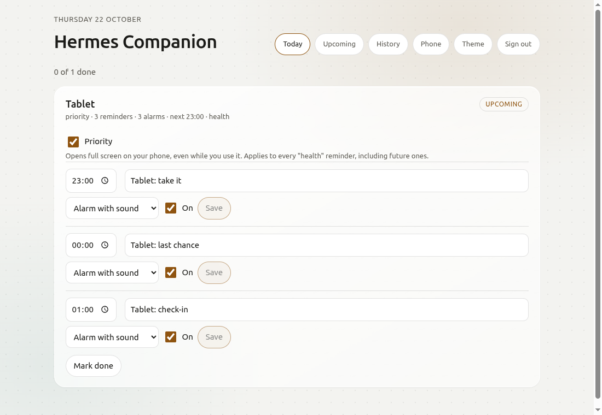
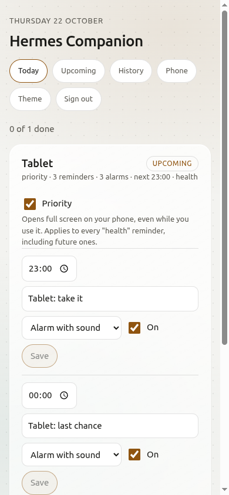

# Hermes Companion

**Reminders you cannot miss. Your AI assistant (or any script) schedules real alarms on your Android phone, and the phone rings them by itself, even offline and on silent.**

Version 0.3.0 · Android · open source (Apache-2.0) · runs on your own computer, no account, no subscription



---

## What is it?
Hermes Companion is three small parts that work together:
1. **A server** that runs on your own computer and keeps your schedule.
2. **An Android app** that receives the schedule and rings the alarms.
3. **A command for your AI assistant** (called "Hermes" here, but any assistant that can run a command will do), so you can say *"remind me to take my tablet at 8"* and it just happens.

There is also an optional **dashboard**, a web page that shows your reminders and lets you change them.

## What problem does it solve?
Normal notifications get missed. They travel through a long chain: your assistant, a server, a push service, your phone's battery manager, an app. If any link breaks (silent mode, battery saving, no signal, a sleeping app), the reminder is late or never arrives. For things that matter, like medication, prayer times or a shift, that is not good enough.

## Why should I use it?
Because the schedule lives **on the phone**. Your assistant sends reminders ahead of time and the phone sets real Android alarms. When the time comes, the phone rings by itself.

| | Push notification apps (ntfy, Pushover and similar) | Phone automation (Tasker and similar) | **Hermes Companion** |
|---|---|---|---|
| Who decides the reminder | Your server, at the moment it fires | You, by hand on the phone | Your assistant, ahead of time |
| Needs a connection when it rings | Yes | No | **No** |
| Real alarm that overrides silent mode | Usually a notification | Yes, if you build it | **Yes, built in** |
| Your answer (Done, Snooze) goes back to the sender | Limited | Not without extra work | **Yes, stored and uploaded later** |
| Tapping Done cancels the rest of that reminder's follow-ups | No | Not without extra work | **Yes** |
| Needs an account with a company | Often | No | **No** |

Those tools are good at what they do. This one is for the case where a missed reminder is not acceptable.

## What can I achieve with it?
- **Medication:** a daily alarm with "Done" or "Snooze". Your assistant can later tell you whether you took it.
- **Prayer times:** a heads-up, a "last chance before it ends" alarm and a check-in for each prayer. Tapping *Prayed* cancels the rest of that prayer's reminders. This is the author's own first use.
- **Work and shifts:** hand-over alarms, "leave now" alarms, end-of-day reviews.
- **Habits:** water, exercise, sleep. The dashboard shows your streak.
- **Anything your assistant should be able to wake you for.**

## Use case scenarios
Real examples of what people do with it. In each one you only talk to your assistant (or use `hc`); the phone and the dashboard do the rest.

### 1. Five daily prayers, with a record of each
**You say:** *"Here is this month's prayer timetable. Remind me for each prayer."*
**What happens:** for each prayer your assistant sends a small group of reminders: a heads-up when the time starts, a "last chance" alarm before it ends, and a check-in afterwards. You switch **Priority** on for them once, so they open **full screen even while you are using the phone**, and they keep doing so every day.
**What you do:** tap **Prayed**. The rest of that prayer's reminders cancel themselves, so you are never nagged for something you already did.
**What you see:** the dashboard shows *3 of 5 done today*, a 14-day strip of done and missed for each prayer, and your assistant can answer *"Did I pray Asr yesterday?"*.

### 2. Medicine, with proof you took it
**You say:** *"Remind me at 8 and 8 in the evening to take my antibiotic for 7 days."*
**What happens:** two alarms a day for a week, each with **Done** and **Snooze 10 min**. Mark it **Priority** and it will always take over the screen.
**What you see:** every dose as done or missed, day by day. Ask *"Did I take the evening one yesterday?"* or show the history to your doctor or pharmacist. If you ring *Done* by accident, **Mark done** on the dashboard is one tap.

### 3. Health habits you want to keep up
**You say:** *"Remind me to drink water every two hours from 9 to 7, to stretch at 3, and to start winding down at 11 pm."*
**What happens:** gentle **banner** reminders (no alarm), because none of these is an emergency. For the ones you really want to keep, such as the evening wind-down, switch the style to *alarm*.
**What you see:** a habit card with a done-and-missed strip for the last 14 days, so you can see your streak without keeping a diary. Ask *"Which habit did I skip most this week?"*.

### 4. Shifts, work and hand-overs
**You say:** *"Wake me 45 minutes before my shift on weekdays, remind me to hand over at 5:30, and to send the invoices on Friday at 4."*
**What happens:** a **priority alarm** for leaving on time, a **silent banner** for the hand-over (so it does not interrupt a meeting), and a normal alarm for the invoices.
**What you see:** everything for the week under **Upcoming**. A shift changed? Move the time on the dashboard instead of asking again.

### 5. Study or focus sessions
**You say:** *"Four 25-minute study sessions with 5-minute breaks, starting at 6 pm."*
**What happens:** eight short reminders: *start*, *break*, *start*… Use **banner, silent** so they nudge without breaking your concentration.
**What you see:** how many sessions you finished each day, which makes a study streak.

### 6. Home, bills and things that come round
**You say:** *"Bins out every Thursday at 9 pm. Car insurance renews on 3 March, remind me a week before. Rent on the 1st."*
**What happens:** one-off reminders days or weeks ahead, plus a repeating series. Because the phone holds the schedule itself, they ring even if your server is down that day.
**What you see:** a quiet calendar of what is coming, and a record that the rent reminder was done.

### 7. Your assistant looks after follow-ups for you
**You say (while working on something with your assistant):** *"Remind me tomorrow at 9 to check the deployment."*
**What happens:** your assistant sets the reminder itself, with a clear title and message. It can also set one at the end of a job it finishes: *"I'll remind you on Friday to review the results."*
**What you do:** tap **Done** when you have checked. Your assistant reads the answer back, so it knows whether to follow up again.

### Choosing how loud it should be
| It matters... | Use | What the phone does |
|---|---|---|
| a lot, must not be missed | **Alarm + Priority** | rings on the alarm volume and opens full screen over whatever you are doing |
| quite a bit | **Alarm** | rings on the alarm volume; shows as a banner at the top while you use the phone |
| a little | **Banner** | a notification with sound |
| but must not interrupt | **Banner, silent** or **Alarm, silent** | appears on screen, no sound |

You can change any reminder's style, time or priority later on the dashboard.

## What do I need?
- An **Android 12 or newer** phone.
- A computer that stays on and runs your assistant: **Linux or macOS** (Windows works through WSL).
- **Docker** on that computer: <https://docs.docker.com/get-docker/>
- **Tailscale** (free) on that computer **and** on your phone, both signed into the **same** Tailscale account: <https://tailscale.com/download>. It lets the phone reach your computer privately from anywhere, with no ports opened to the internet.
- An AI assistant that can run a command (optional: you can also use the `hc` command yourself).

## How do I set it up?
It takes about ten minutes. Do the steps in order.

**1. Tools (once).** Install Docker. Install Tailscale on the computer and on the phone, and sign both into the same account.

**2. Install the server.** On the computer, run one command:
```sh
curl -fsSL https://raw.githubusercontent.com/Nehian/hermes-companion/main/install.sh | sh
```
It checks Docker and Tailscale, builds and starts the server, and prints the two things you need next:
```
Server address:  100.x.x.x
Pairing code:    ABCD2345     (valid for 60 minutes, works once)
```

**3. Install the app.** On your phone, open the [latest release](https://github.com/Nehian/hermes-companion/releases/latest), download `HermesCompanion-0.3.0.apk` and open it. Android will ask you to allow installing from this source. Say yes.

**4. Pair the phone.** Open the app, go to **Settings**, type the **server address** and the **pairing code**, and tap **Pair**. Then tap **Allow** on each row that says "Needs attention" (alarms, full-screen, battery, and *show priority alarms over other apps*). Tap **Ring a test alarm** to hear it, and **Ring a priority test alarm**, then open another app, to see a priority alarm take over the screen.

**5. Teach your assistant.** On the computer, run:
```sh
~/hermes-companion/connect-agent.sh
```
It copies a short instruction file into your assistant's skills folder (Hermes, Claude Code and Codex are found automatically). If it finds none, it prints one sentence to paste into your assistant's chat.

**6. Check that everything works.**
```sh
~/hermes-companion/hc doctor --ring
```
It checks the server, the phone and Tailscale, then rings a test alarm in one minute. It ends with `ALL GOOD` or one line saying what to fix.

**7. Optional: turn on the dashboard.**
```sh
~/hermes-companion/dashboard.sh
```
It asks you to choose a password, then prints the address to open.

## How do I use it every day?
Just talk to your assistant: *"Remind me to take my tablet every morning at 8 for two weeks."*
- Your assistant asks one short question each time: **alarm on your phone, a message in your chat, or both?** Your answer applies to that reminder only.
- The reminder reaches your phone the next time the app syncs (when you open it, about every 15 minutes in the background, and just before each alarm).
- At the time, the phone rings. Tap **Done** or **Snooze**.
- Ask *"Did I take it?"* and your assistant reads your answers back.

You can also use the command yourself:
```sh
hc send --title "Stand up" --in 30m
hc send --title "Take tablet" --at 08:00 --repeat daily --days 14
hc list          # what is waiting
hc answers       # what you answered
hc cancel JOB_ID
```

## What does the dashboard do?
It is a web page served by your own server, reachable over Tailscale. It is **off** until you run `dashboard.sh`, and it has a password you choose.
- **Today and Upcoming:** every reminder, grouped by activity, with its state (upcoming, done, missed, switched off).
- **History:** the last 14 days, with a done/missed strip for each habit.
- **Phone:** which phones are paired and when each last synced.
- It refreshes itself every few seconds, so an answer you give on the phone shows up without reloading.



## What can I customise?
**On the phone (Settings → Sound):** the alarm tone, how loud it rings, and whether it always vibrates.

**On the dashboard, for each reminder:** its time, its title, its style, and an on/off switch. For each activity: a **Priority** switch and a **Mark done** button.

**Priority:** off by default. When it is on, the phone opens the reminder **full screen** straight away, even while you are using another app, instead of only showing a banner at the top. For a named category (for example `prayer`) the switch also covers every future reminder in that category, so you turn it on once. It needs the *show over other apps* permission, which the app's Settings page asks for.
Styles: *alarm with sound*, *alarm, silent*, *banner with sound*, *banner, silent*. Your phone picks up the change the next time it syncs. A reminder you switch off stays visible and can be switched back on.

The split is simple: the phone decides **how it sounds**, the dashboard and your assistant decide **what each reminder does**.

## Is it safe and private?
- Your schedule and answers stay on **your own computer**. There is no cloud service and no account.
- The server answers only to your own Tailscale network and the computer itself. Nothing is opened to the internet.
- Each phone gets its own revocable key when it pairs. The pairing code works once.
- Your assistant never sees the admin key: the `hc` command reads it from a file by itself.
- The dashboard is off until you switch it on, asks for a password, and stores only a scrambled copy of it.
- Alarm buttons do a fixed set of things (done, snooze, and so on). Nothing can run code on your phone.
- Anyone who is signed into **your Tailscale account** can reach the server's address, so protect that account. See [SECURITY.md](SECURITY.md) to report a problem privately.

## What are the limits?
- **Android only**, version 12 or newer.
- You **install the app yourself** (from the release page). Google Play restricts the exact-alarm permission this app needs.
- It is built for **one person**: one server per person, as many phones as you like.
- Reminders reach the phone when it syncs, so **send them ahead of time** (minutes or hours, not seconds).
- Do not **Force stop** the app: Android then clears its alarms until you open it again.
- On some phones (Samsung especially) switch off battery optimisation for the app, or Android may delay it.
- Tested by the author on one real Samsung phone and the Android 16 emulator. Reports from other phones are very welcome.

## Something went wrong. What do I do?
Run `hc doctor`. It ends with one line saying what to fix. The common ones:

| It says | Do this |
|---|---|
| Docker is not running | Start Docker, run the install command again |
| Tailscale is not signed in | Run `sudo tailscale up` and sign in, then run the install command again |
| no phone is paired | Run `./pair.sh` for a fresh code and enter it in the app |
| no phone has synced yet | Open the app once |
| the pairing code is wrong or has expired | Run `./pair.sh` for a new one |

Still stuck? Open an issue. Include the output of `hc doctor` (it never prints secrets).

## How does it work inside?
```
 your assistant ── hc send ──►  your server  ◄── sync ──►  the app on your phone
                                (FastAPI + SQLite, Docker)       rings exact alarms,
                                      ▲                          sends your answers back
                                      └── the dashboard reads the same server
```
The server stores reminders and answers. The phone downloads the schedule, sets exact Android alarms, and rings them without any connection. A short check just before each alarm drops reminders that were cancelled in the meantime, so you are never rung for something you already handled.

For the full technical reference see [docs/API.md](docs/API.md). To build the app or run the server by hand, see [docs/BUILD.md](docs/BUILD.md).

## Can I help?
Yes. Apache License 2.0, see [LICENSE](LICENSE) and [NOTICE](NOTICE). Contributions are welcome, see [CONTRIBUTING.md](CONTRIBUTING.md).
